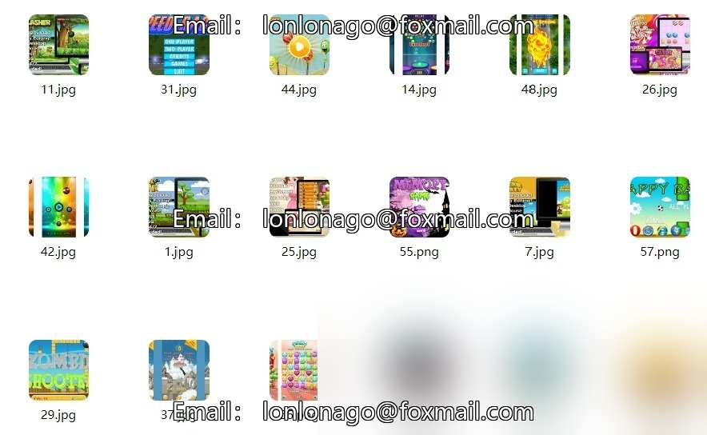
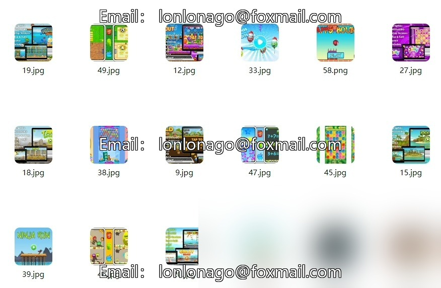
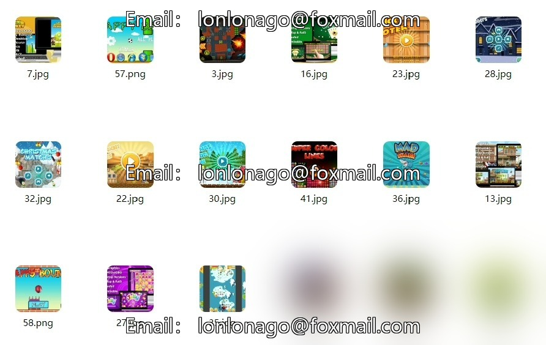
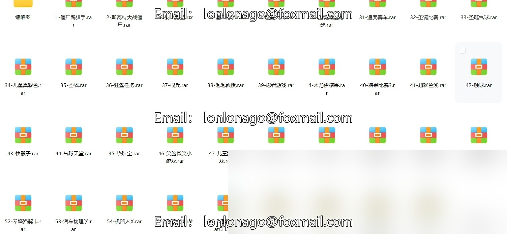

# 60 sets of h5 game source code html5 game source code js game source code complete set

## Body

60 sets of H5 mini game source code HTML5 mini game JS mini game source code complete list

The source code of the H5 mini-game is an excellent resource for learning and developing games. Both beginners and senior developers can benefit from it. These resources cover various types including casual, puzzle, and action, meeting different needs. They are open-source and have been tested, guaranteeing usability, with clear structure that is easy to understand and for secondary development. These source code resources not only enhance development skills but also stimulate creativity, serving as a powerful assistant on the path to game development!

online trading, and direct ordering allows immediate shipping.
I am online at long-term and will ship immediately.

The materials include 60 H5 game source codes and various game resources, covering multiple game types, software names, thumbnails and related files, with guidance on learning and development.

<!-- AI_ENRICHED -->

## Images

## Payment

Here is a pay link on Stripe ( https://buy.stripe.com/3cs8yP7sY87d0vu9AB ). Please contact me lonlonago@foxmail.com after funding $89, and I will send you a complete data files , thank you!

